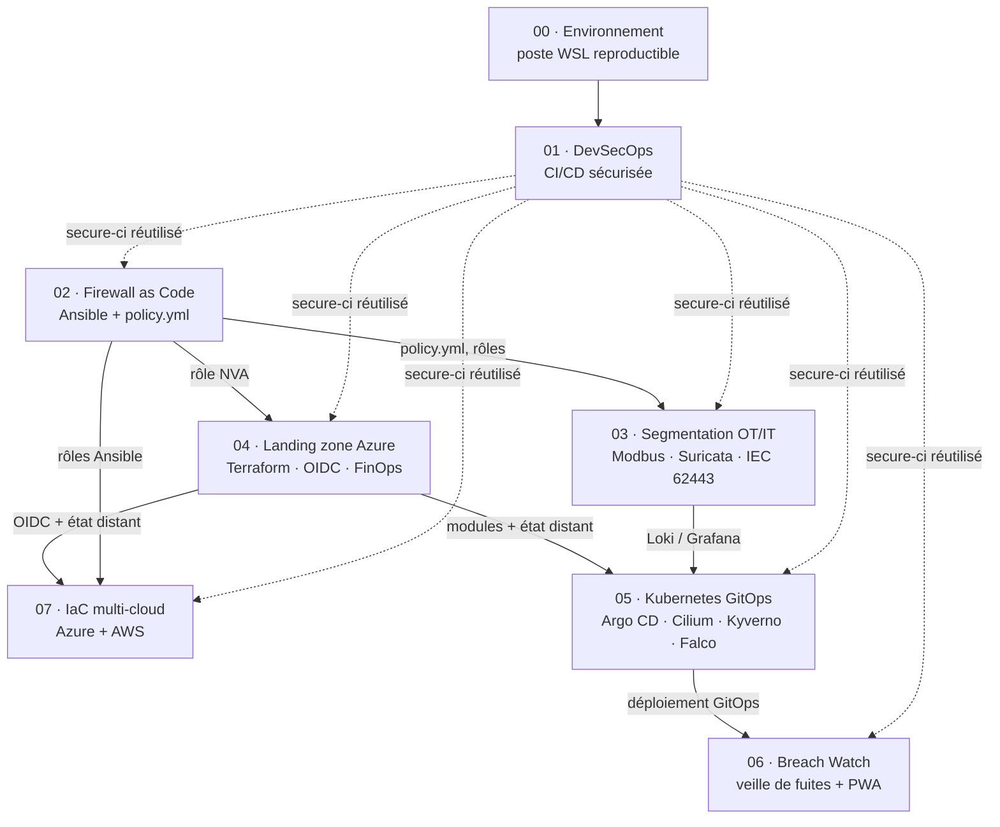

# Portfolio · Cloud, Réseau, Sécurité OT/IT

[](https://github.com/S-Rif/portfolio/actions/workflows/qualite.yml)
[](https://github.com/S-Rif/portfolio/actions/workflows/labs.yml)

Sept labs reliés, plus un lab d'environnement, construits autour d'un site industriel fictif : l'**Usine HubLabs**. Chaque lab démontre une compétence attendue d'un ingénieur cloud et réseau en environnement industriel : CI/CD sécurisée, pare-feu en code, segmentation OT/IT, landing zone Azure, IaC multi-cloud, Kubernetes GitOps et application de veille.

Chaque lab est **réplicable** (un clone propre suffit), **prouvé** (aucun objectif validé sans preuve), **gratuit par défaut** (option payante plafonnée) et **automatisé par des workflows** : il n'y a aucun script dans ce dépôt.

## Le fil rouge : HubLabs

HubLabs est une entreprise industrielle fictive à trois sites, Lyon, Grenoble et Dijon, qui migre son application de supervision vers Azure. L'Usine HubLabs, à Lyon, sert de terrain à tous les labs. Un site virtuel dans le cloud (CLD) et une option de site international (Maroc ou Espagne) complètent le périmètre.

Aucune donnée réelle de client, d'employeur ou de personne : noms, plages d'adresses et domaines (`hublabs.example`) sont fictifs. Les valeurs communes vivent dans le [référentiel](docs/referentiel/README.md).

## Comment les labs s'enchaînent



## Les labs

Classés dans l'ordre de réalisation : le 07 passe avant le 05 parce qu'il réutilise directement l'état distant du 04.

| # | Lab | Ce que ça démontre | Stack | Semaine | Statut |
| --- | --- | --- | --- | --- | --- |
| 00 | [Environnement](labs/00-environnement/README.md) | Poste Linux reproductible, commits signés, secrets bloqués avant commit | WSL2, Docker Engine, Git, pre-commit, gitleaks | S1 | À faire |
| 01 | [DevSecOps](labs/01-devsecops/README.md) | CI/CD qui bloque secrets et failles, SBOM, signature sans clé | GitHub Actions, GitLab CI, gitleaks, Semgrep, Checkov, Trivy, Syft, Cosign | S1–S2 | À faire |
| 02 | [Firewall as Code](labs/02-firewall-as-code/README.md) | Pare-feu déclaratif, tests de flux, détection de dérive | Ansible, Molecule, nftables, FortiGate en bonus | S2–S3 | À faire |
| 03 | [Segmentation OT/IT](labs/03-segmentation-ot-it/README.md) | Modèle Purdue, zones et conduits IEC 62443, détection Modbus | Docker, Suricata, Loki, Grafana, Packet Tracer | S4 | À faire |
| 04 | [Landing zone Azure](labs/04-landing-zone-azure/README.md) | Hub-spoke, Azure Policy, budget, déploiement sans secret (OIDC) | Terraform, Azure | S5 | À faire |
| 07 | [IaC multi-cloud](labs/07-iac-multicloud/README.md) | Même module sur Azure et AWS, IPsec inter-cloud | Terraform, Ansible, GitHub Actions, GitLab CI | S6–S7 | À faire |
| 05 | [Kubernetes GitOps](labs/05-kubernetes-gitops/README.md) | Kubernetes durci, GitOps, refus des images non signées | kind, AKS, Argo CD, Cilium, Kyverno, Falco | S8 | À faire |
| 06 | [Breach Watch](labs/06-breach-watch/README.md) | Veille de fuites, notifications, vie privée par conception | Python, FastAPI, PWA | S9 | À faire |

Tableau de bord détaillé et méthode : [labs/README.md](labs/README.md) · [labs/methode.md](labs/methode.md).

## Démo en entretien (10 minutes)

| Minute | Contenu |
| --- | --- |
| 0–1 | Le contexte HubLabs et le problème : une usine qui migre sa supervision vers le cloud sans ouvrir son OT |
| 1–3 | Lab 01 : un faux secret poussé, le pipeline s'arrête ; correction, image signée et vérifiée |
| 3–5 | Lab 02 : un flux ajouté dans la matrice, règle générée et testée ; une règle ajoutée à la main est détectée |
| 5–7 | Lab 03 : requête Modbus depuis l'IT bloquée et levée dans Grafana |
| 7–9 | Lab 04 ou 05 : plan relu, apply approuvé sans secret, ou retour arrière par `git revert` |
| 9–10 | Coût réel, limites assumées, ce que je ferais en production |

La démo se joue en local de préférence, sur un clone propre ; les workflows du dépôt servent de preuve en ligne.

## Automatisation : les workflows

| Workflow | Déclenchement | Rôle |
| --- | --- | --- |
| [`qualite`](.github/workflows/qualite.yml) | Push sur `main`, PR, manuel | Hooks pre-commit (Markdown, YAML, workflows, secrets), liens internes, secrets dans tout l'historique, contrat des labs, objectifs validés sans preuve, noms et données interdits |
| [`labs`](.github/workflows/labs.yml) | Modification d'un lab, manuel (`lab`, `site_intl`) | Contrôle de chaque lab modifié, en parallèle : contrat, tableau de bord, Compose, Terraform, Ansible, GitOps |
| [`lab-reutilisable`](.github/workflows/lab-reutilisable.yml) | Appelé par `labs` | Contrôle d'un lab, réutilisable |
| [`liens-externes`](.github/workflows/liens-externes.yml) | Chaque lundi, manuel | Liens vers l'extérieur, hors du chemin bloquant |
| [`release`](.github/workflows/release.yml) | Tag `lab-NN-v*` ou `hub-v*` | Publie la version avec ses notes |

Toutes les actions tierces sont épinglées par SHA de commit et chaque job a des permissions minimales.

## Structure du dépôt

```text
portfolio/
├── .github/workflows/     # toute l'automatisation
├── docs/referentiel/      # adressage, matrice de flux, valeurs communes
├── labs/
│   ├── README.md          # index et tableau de bord
│   ├── methode.md         # cycle d'un lab, preuves, conventions
│   ├── _gabarits/         # modèle d'un nouveau lab
│   └── NN-nom-du-lab/     # README, objectifs, préparation, planning,
│                          # réplication, compte-rendu, preuves/, adr/
├── CHANGELOG.md · CONTRIBUTING.md · SECURITY.md · LICENSE
└── .pre-commit-config.yaml · .markdownlint-cli2.jsonc · .lycheeignore
```

## Budget

- Plafond global : **100 €** pour l'ensemble du parcours.
- Chaque lab a une version **gratuite** complète ; l'option payante est plafonnée à **15–20 €**.
- **Un seul** lab payant actif à la fois, budget et alerte créés **avant** le premier déploiement.
- Toute ressource cloud est **détruite en fin de séance** ; la destruction fait partie des preuves.

## Feuille de route

| Semaine | Jalon |
| --- | --- |
| S1 | Lab 00 (poste prêt) et lab 01 en version minimale |
| S2–S3 | Lab 01 complet, lab 02 Firewall as Code |
| S4 | Lab 03 Segmentation OT/IT et maquette Packet Tracer |
| S5 | Lab 04 Landing zone Azure |
| S6–S7 | Lab 07 IaC multi-cloud |
| S8 | Lab 05 Kubernetes GitOps |
| S9 | Lab 06 Breach Watch |
| S10 | Portfolio publiable : relecture, démo chronométrée, dépôt public |

## Rejouer un lab

Prérequis : le [lab 00](labs/00-environnement/README.md). Ensuite, chaque lab se rejoue seul, sans cloner tout le dépôt :

```bash
git clone --filter=blob:none --sparse git@github.com:S-Rif/portfolio.git && cd portfolio
git sparse-checkout set labs/02-firewall-as-code docs/referentiel
```

Puis suivre `replication.md` du lab. Le contrôle en CI se lance avec `gh workflow run labs -f lab=02`.

## Contribuer

Le dépôt est partagé avec les personnes qui suivent la formation. Règles : [CONTRIBUTING.md](CONTRIBUTING.md). Signalement de sécurité : [SECURITY.md](SECURITY.md).

## Licence

[MIT](LICENSE).

## In English

A hands-on portfolio of seven linked labs around a fictional industrial site, HubLabs: secure CI/CD, firewall as code, OT/IT segmentation, Azure landing zone, multi-cloud IaC, hardened Kubernetes with GitOps, and a privacy-first breach-monitoring app. Every lab is reproducible from a clean clone, free by default, proven with dated evidence, and automated through GitHub Actions workflows only.
