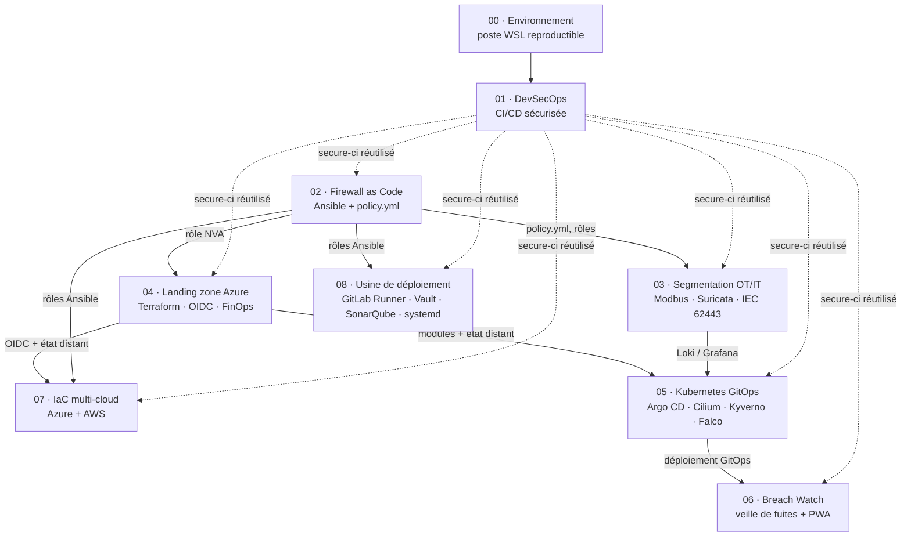

# Portfolio · Cloud, Réseau, Sécurité OT/IT

[](https://github.com/S-Rif/portfolio/actions/workflows/qualite.yml)
[](https://github.com/S-Rif/portfolio/actions/workflows/labs.yml)

Huit labs reliés, plus un lab d'environnement, construits autour d'un site industriel fictif : l'**Usine HubLabs**. Chaque lab démontre une compétence attendue d'un ingénieur cloud et réseau en environnement industriel : CI/CD sécurisée, pare-feu en code, segmentation OT/IT, landing zone Azure, IaC multi-cloud, Kubernetes GitOps, application de veille et usine de déploiement on-prem.

Chaque lab est **réplicable** (un clone propre suffit), **prouvé** (aucun objectif validé sans preuve), **gratuit par défaut** (option payante plafonnée) et **contrôlé en CI** par les workflows du dépôt.

| Vitrine | Labs | Démo |
| --- | --- | --- |
| Cette page : le fil rouge, les labs, ce qu'ils démontrent | [labs/](labs/README.md) : tableau de bord, contrat, méthode | [demo/](demo/README.md) : deux parcours de 10 minutes et leur plan B |

## Le fil rouge : HubLabs

HubLabs est une entreprise industrielle fictive à trois sites, Lyon, Grenoble et Dijon, qui migre son application de supervision vers Azure et industrialise le déploiement de ses outils internes. L'Usine HubLabs, à Lyon, sert de terrain à tous les labs. Un site virtuel dans le cloud (CLD) et une option de site international (Maroc ou Espagne) complètent le périmètre.

Aucune donnée réelle de client, d'employeur ou de personne : noms, plages d'adresses et domaines (`hublabs.example`) sont fictifs. Les valeurs communes vivent dans le [référentiel](docs/referentiel/README.md).

## Comment les labs s'enchaînent



## Les labs

| # | Lab | Ce que ça démontre | Stack | Statut |
| --- | --- | --- | --- | --- |
| 00 | [Environnement](labs/00-environnement/README.md) | Poste Linux reproductible, commits signés, secrets bloqués avant commit | WSL2, Docker Engine, Git, pre-commit, gitleaks | À faire |
| 01 | [DevSecOps](labs/01-devsecops/README.md) | CI/CD qui bloque secrets et failles, SBOM, signature sans clé | GitHub Actions, GitLab CI, gitleaks, Semgrep, Checkov, Trivy, Syft, Cosign | À faire |
| 02 | [Firewall as Code](labs/02-firewall-as-code/README.md) | Pare-feu déclaratif, tests de flux, détection de dérive | Ansible, Molecule, nftables, FortiGate en bonus | À faire |
| 03 | [Segmentation OT/IT](labs/03-segmentation-ot-it/README.md) | Modèle Purdue, zones et conduits IEC 62443, détection Modbus | Docker, Suricata, Loki, Grafana, Packet Tracer | À faire |
| 04 | [Landing zone Azure](labs/04-landing-zone-azure/README.md) | Hub-spoke, Azure Policy, budget, déploiement sans secret (OIDC) | Terraform, Azure | À faire |
| 07 | [IaC multi-cloud](labs/07-iac-multicloud/README.md) | Même module sur Azure et AWS, IPsec inter-cloud | Terraform, Ansible, GitHub Actions, GitLab CI | À faire |
| 05 | [Kubernetes GitOps](labs/05-kubernetes-gitops/README.md) | Kubernetes durci, GitOps, refus des images non signées | kind, AKS, Argo CD, Cilium, Kyverno, Falco | À faire |
| 06 | [Breach Watch](labs/06-breach-watch/README.md) | Veille de fuites, notifications, vie privée par conception | Python, FastAPI, PWA | À faire |
| 08 | [Usine de déploiement on-prem](labs/08-usine-deploiement/README.md) | Un template GitLab pour N scripts × 2 environnements, quality gate, secrets Vault, timers systemd, rollback | GitLab CI, Terraform, Ansible, Vault, SonarQube, systemd, Vue, nginx | À faire |

Classés dans l'ordre de réalisation. Tableau de bord, contrat et méthode : [labs/README.md](labs/README.md).

## Démo en entretien

Deux parcours de 10 minutes, choisis selon le poste : **A · Cloud et OT** (labs 01, 02, 03, 04 ou 05) et **B · Usine de déploiement** (labs 01, 08, 02). Minutage, préparation et plan B : [demo/README.md](demo/README.md).

## Rejouer un lab

Prérequis : le [lab 00](labs/00-environnement/README.md). Ensuite, chaque lab se rejoue seul, sans cloner tout le dépôt :

```bash
git clone --filter=blob:none --sparse git@github.com:S-Rif/portfolio.git && cd portfolio
git sparse-checkout set labs/02-firewall-as-code docs/referentiel
```

Puis suivre la section « Rejouer » du `guide.md` du lab. Le contrôle en CI se lance avec `gh workflow run labs -f lab=02`.

## Budget

Plafond global de **100 €**. Chaque lab a une version **gratuite** complète ; l'option payante est plafonnée à **15–20 €**, un seul lab payant actif à la fois, et toute ressource cloud est **détruite en fin de séance**.

## Structure du dépôt

```text
portfolio/
├── README.md              # vitrine
├── demo/                  # parcours de démo, préparation, plan B
├── labs/
│   ├── README.md          # tableau de bord, contrat, méthode
│   ├── _gabarit/          # modèle d'un nouveau lab
│   └── NN-nom-du-lab/     # README, objectifs, guide, journal, adr/, preuves/
├── docs/referentiel/      # adressage, matrice de flux, valeurs communes
├── .github/workflows/     # qualite, labs, liens-externes, release
└── CHANGELOG.md · CONTRIBUTING.md · SECURITY.md · LICENSE
```

## Contribuer

Le dépôt est partagé avec les personnes qui suivent la formation. Règles, conventions et workflows : [CONTRIBUTING.md](CONTRIBUTING.md). Signalement de sécurité : [SECURITY.md](SECURITY.md).

## Licence

[MIT](LICENSE).

## In English

A hands-on portfolio of eight linked labs around a fictional industrial site, HubLabs: secure CI/CD, firewall as code, OT/IT segmentation, Azure landing zone, multi-cloud IaC, hardened Kubernetes with GitOps, a privacy-first breach-monitoring app and an on-prem deployment factory. Every lab is reproducible from a clean clone, free by default, proven with dated evidence and checked in CI. Two 10-minute demo paths live in `demo/`.
