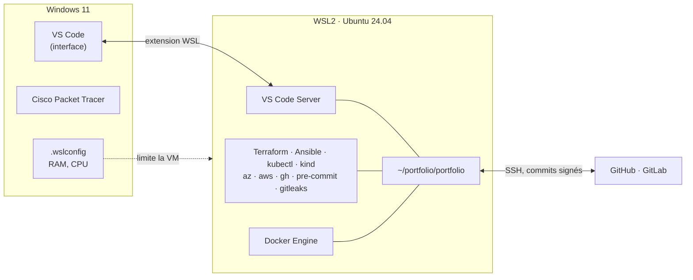

# Lab 00 · Environnement

> **HubLabs · Usine HubLabs.** Avant le premier lab, le poste doit être prêt, identique d'une séance à l'autre et vérifiable par un tiers.
>
> **Pitch (EN)** : A Windows laptop turned into a reproducible Linux engineering workstation that runs every lab with no paid licence and no stored secret.

| Statut | Séances de 90 min | Coût | Exécution |
| --- | --- | --- | --- |
| À faire | 4 | 0 € | poste |

## Le problème métier

Sans poste maîtrisé, chaque lab commence par une heure de dépannage et chaque résultat dépend d'un état de machine que personne ne connaît. Ce lab fixe un environnement documenté, versionné et vérifiable : n'importe quel étudiant obtient le même poste en moins d'une heure, et chaque outil a sa version relevée en preuve.

## Schéma



## Ce que ça démontre

- Un poste Linux reproductible sous Windows, sans licence payante.
- Des commits signés, affichés « Verified » sur GitHub.
- Un faux secret bloqué avant même le commit.
- Des versions d'outils relevées en preuve, donc un lab rejouable.

## Place dans le portfolio

| Sites concernés | S'appuie sur | Fournit |
| --- | --- | --- |
| — | — | Poste de travail reproductible pour tous les labs |

Sites, plages, nommage et flux viennent du [référentiel](../../docs/referentiel/README.md). Aucune valeur en dur dans ce lab.

## Exécution

Contrôle en CI, sans rien installer :

```bash
gh workflow run labs -f lab=00                    # contrôle du lab
gh run watch
```

En local, pas à pas : [guide, section Rejouer](guide.md#rejouer).

## Option site international

Sans objet pour le poste : le site international est une option des labs 01 à 07.

## Scénario de démo (5 minutes)

1. Clone propre du dépôt, puis `pre-commit run --all-files` : tout est vert.
2. Commit d'un faux jeton : refusé par le hook gitleaks.
3. Commit signé poussé : badge « Verified » sur GitHub.
4. `docker run --rm hello-world` sans `sudo`, après un `wsl --shutdown`.

## Sous le capot

Le disque Linux de WSL2 est un disque virtuel ext4 lu directement par le noyau de la VM. `/mnt/c` est le disque Windows exposé par un protocole de partage de fichiers (9P) : chaque accès traverse la frontière VM/hôte, les notifications de modification de fichiers ne passent pas, et les droits Linux (bit d'exécution) ne sont pas conservés. Docker Engine est un service : sans systemd en processus 1, il faut le relancer à chaque ouverture. Enfin, `user.name` et `user.email` sont déclaratifs : seule la signature prouve l'auteur d'un commit, et GitHub l'affiche « Verified » quand la clé est déclarée en signature sur le compte.

## Documents

[Objectifs et preuves](objectifs.md) · [Guide](guide.md) · [Journal](journal.md) · [Décision d'architecture](adr/ADR-001.md)
