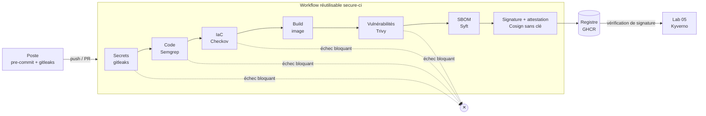

# Lab 01 · DevSecOps

> **HubLabs · Usine HubLabs.** L'Usine HubLabs lance six projets d'infrastructure. Ce lab leur fournit un socle de pipelines sécurisés, appelé en trois lignes, maintenu à un seul endroit et versionné.
>
> **Pitch (EN)** : Reusable secure CI/CD templates for GitHub Actions and GitLab CI: any lab gets secret detection, code and IaC scanning, image scanning, SBOM and keyless signing in three lines.

| Statut | Semaine | Coût | Exécution | Emplacement |
| --- | --- | --- | --- | --- |
| À faire | S1 (MVP), S2 (complet) | 0 € | ci | `labs/01-devsecops` |

## Le problème métier

Sans socle commun, chaque équipe réinvente sa CI : aucun contrôle de secrets partagé, images ni scannées ni signées, aucune traçabilité de ce qui tourne. Contraintes de la direction : 0 € de licence, aucun secret statique dans les dépôts ni dans la CI, un seul endroit à maintenir, et bloquer plutôt qu'alerter sur les risques majeurs, avec des exceptions tracées.

## Schéma



## Ce que ça démontre

- Une chaîne CI/CD qui **bloque** au lieu d'alerter : un secret, une faille critique corrigeable ou une IaC dangereuse arrêtent le pipeline.
- Une image **signée sans clé stockée** (OIDC + Sigstore), vérifiable par n'importe qui.
- Un socle **réutilisé** par les autres labs, en GitHub Actions et en GitLab CI.

## Place dans le portfolio

| Sites concernés | S'appuie sur | Fournit |
| --- | --- | --- |
| CLD | 00 (poste, Git signé, pre-commit) | Workflow réutilisable `secure-ci` (labs 02 à 07), image signée (lab 05) |

Sites, plages, nommage et flux viennent du [référentiel](../../docs/referentiel/README.md). Aucune valeur en dur dans ce lab.

## Exécution

En CI, depuis n'importe quel poste :

```bash
gh workflow run labs -f lab=01                    # contrôle du lab
gh workflow run labs -f lab=01 -f site_intl=ma    # variante site international
gh run watch
```

En local (cible, disponible quand le lab est implémenté) :

```bash
pre-commit run --all-files
gh workflow run labs -f lab=01
gh run watch
cosign verify ghcr.io/s-rif/portfolio/supervision@sha256:<digest> \
  --certificate-identity-regexp '^https://github.com/S-Rif/portfolio/' \
  --certificate-oidc-issuer https://token.actions.githubusercontent.com
```

Conventions détectées par le workflow `labs` : `compose.yaml` (service `tests`, profils `intl-ma` et `intl-es`), `terraform/`, `ansible/`, `gitops/overlays/`. Voir la [méthode](../methode.md).

## Option site international

La politique de conformité lit `SITE_INTL` : un plan Terraform qui déploie hors des régions autorisées pour le site choisi est refusé (résidence des données).

## Scénario de démo (5 minutes)

1. Deux incidents classiques en introduction : un jeton commité, une image non vérifiée en production.
2. Push d'un faux secret puis d'une faille volontaire : le pipeline s'arrête sur chacun.
3. Correction, nouveau push : pipeline vert, image publiée.
4. `cosign verify` en direct sur le digest, lecture du SBOM.
5. `SITE_INTL=es` puis région non autorisée : la politique refuse le plan.

## Sous le capot

Signer sans clé : le job demande à GitHub un jeton OIDC (d'où `id-token: write`) qui atteste « ce workflow, de ce dépôt, sur cette référence ». Cosign génère une paire de clés éphémère, Fulcio délivre un certificat de quelques minutes qui lie la clé publique à cette identité, l'image est signée, la clé privée jetée, et la signature est inscrite dans Rekor, journal de transparence public. À la vérification, on ne demande pas « quelle clé ? » mais « signé par quel workflow, attesté par quel émetteur ? ». On signe et on scanne le **digest** (`@sha256:…`) et jamais un tag, car un tag est une étiquette déplaçable.

## Documents

[Objectifs](objectifs.md) · [Préparation](preparation.md) · [Planning](planning.md) · [Réplication](replication.md) · [Compte-rendu](compte-rendu.md) · [Preuves](preuves/README.md) · [Décision d'architecture](adr/ADR-001.md)
