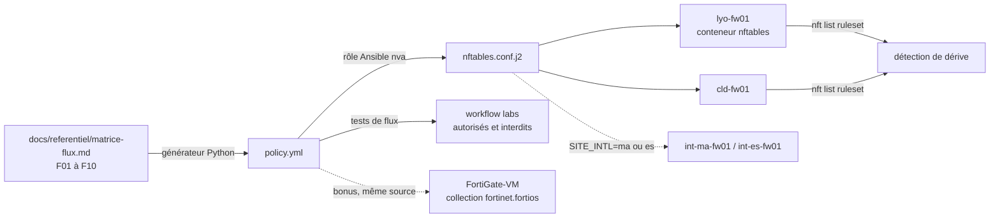

# Lab 02 · Firewall as Code

> **HubLabs · Usine HubLabs.** Les pare-feu de l'Usine HubLabs sont décrits en code depuis la matrice de flux du référentiel. Une règle n'existe que si elle est dans Git, relue, testée, puis appliquée.
>
> **Pitch (EN)** : Firewall rules generated from a single flow matrix, tested in CI and checked for drift: no click-ops, no undocumented rule.

| Statut | Semaine | Coût | Exécution | Emplacement |
| --- | --- | --- | --- | --- |
| À faire | S2–S3 | 0 € | local | `labs/02-firewall-as-code` |

## Le problème métier

Dans une usine, un pare-feu administré à la souris dérive en quelques mois : règles temporaires jamais retirées, doublons, aucune trace de qui a ouvert quoi. Le jour d'un audit IEC 62443 ou d'un incident, personne ne sait justifier une règle. Ce lab inverse la logique : la matrice de flux est la source de vérité, les règles en sont générées, et tout écart entre le pare-feu et Git est détecté.

## Schéma



## Ce que ça démontre

- Une politique de filtrage déclarative, générée et non saisie à la main.
- Des tests de flux positifs **et** négatifs exécutés en CI, comme des tests unitaires.
- Une application idempotente (`changed=0` au second passage) et un retour arrière par `git revert`.
- La détection d'une règle ajoutée hors processus (dérive).

## Place dans le portfolio

| Sites concernés | S'appuie sur | Fournit |
| --- | --- | --- |
| LYO, CLD, INT (option) | 01 (`secure-ci`) | `policy.yml` (lab 03), rôle Ansible `nva` (labs 04 et 07) |

Sites, plages, nommage et flux viennent du [référentiel](../../docs/referentiel/README.md). Aucune valeur en dur dans ce lab.

## Exécution

En CI, depuis n'importe quel poste :

```bash
gh workflow run labs -f lab=02                    # contrôle du lab
gh workflow run labs -f lab=02 -f site_intl=ma    # variante site international
gh run watch
```

En local (cible, disponible quand le lab est implémenté) :

```bash
cd labs/02-firewall-as-code
docker compose up -d --wait                           # montage
docker compose run --rm tests                         # un test par objectif
COMPOSE_PROFILES=intl-ma docker compose up -d --wait  # variante site international
docker compose down -v --remove-orphans               # toujours en fin de séance
```

Conventions détectées par le workflow `labs` : `compose.yaml` (service `tests`, profils `intl-ma` et `intl-es`), `terraform/`, `ansible/`, `gitops/overlays/`. Voir la [méthode](../methode.md).

## Option site international

Ajoute le pare-feu du site international (`int-ma-fw01` ou `int-es-fw01`) et ses deux règles de la matrice : F07 autorise la télémaintenance vers le bastion de l'iDMZ (SSH, sessions tracées), F08 interdit tout accès direct à l'OT. En local, le lien vers le hub est un réseau Docker dédié ; l'IPsec réel est construit dans le lab 04.

## Scénario de démo (5 minutes)

1. Ajouter un flux dans la matrice, pousser : la CI génère la règle et lance les tests.
2. Le workflow `labs` monte la topologie et rejoue les tests de flux : vert.
3. Ajouter une règle à la main dans `lyo-fw01` : le test de dérive échoue et nomme la règle.
4. `gh workflow run labs -f lab=02 -f site_intl=ma` : le technicien distant atteint le bastion, pas l'automate.

## Documents

[Objectifs](objectifs.md) · [Préparation](preparation.md) · [Planning](planning.md) · [Réplication](replication.md) · [Compte-rendu](compte-rendu.md) · [Preuves](preuves/README.md) · [Décision d'architecture](adr/ADR-001.md)
