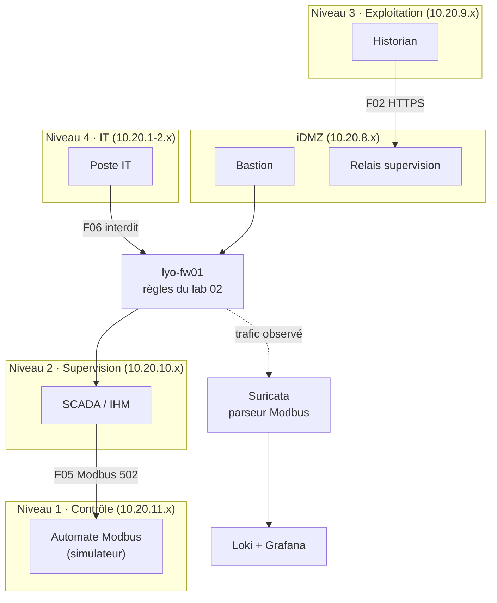

# Lab 03 · Segmentation OT/IT

> **HubLabs · Usine HubLabs.** L'Usine HubLabs est segmentée selon le modèle Purdue et les zones et conduits IEC 62443. Le lab prouve que l'IT, le cloud et les sites distants n'atteignent l'OT que par l'iDMZ, et que toute tentative est détectée.
>
> **Pitch (EN)** : An industrial site segmented along the Purdue model and IEC 62443 zones and conduits, where every attempt to reach the OT outside the iDMZ is blocked and detected.

| Statut | Séances de 90 min | Coût | Exécution |
| --- | --- | --- | --- |
| À faire | 4 | 0 € | local |

## Le problème métier

Un automate parle Modbus TCP : aucun chiffrement, aucune authentification. Quiconque atteint le port 502 peut lire et écrire des registres. La seule défense réaliste est architecturale : des zones étanches, des conduits explicites et une détection sur chaque conduit. Ce lab construit cette architecture en conteneurs, la double d'une maquette Packet Tracer multi-sites et la rend observable.

## Schéma



## Ce que ça démontre

- Une architecture Purdue et IEC 62443 réelle, avec plan d'adressage par zone.
- Un conduit Modbus autorisé uniquement entre supervision et automates.
- Une détection d'intrusion qui comprend le protocole industriel, visible dans un tableau de bord.
- Une maquette réseau multi-sites (Packet Tracer) cohérente avec le même adressage.

## Place dans le portfolio

| Sites concernés | S'appuie sur | Fournit |
| --- | --- | --- |
| LYO, GRE, DIJ, CLD, INT (option) | 02 (`policy.yml`, rôle `nva`) | Zones OT, pile d'observabilité Loki et Grafana (lab 05) |

Sites, plages, nommage et flux viennent du [référentiel](../../docs/referentiel/README.md). Aucune valeur en dur dans ce lab.

## Exécution

Contrôle en CI, sans rien installer :

```bash
gh workflow run labs -f lab=03                    # contrôle du lab
gh workflow run labs -f lab=03 -f site_intl=ma    # variante site international
gh run watch
```

En local, pas à pas : [guide, section Rejouer](guide.md#rejouer).

## Option site international

Ajoute le site international dans la maquette Packet Tracer (lien WAN vers le hub) et un conteneur « technicien distant ». Sa tentative Modbus directe vers l'automate est bloquée (F08) et levée par Suricata ; sa connexion au bastion (F07) est autorisée et journalisée en UTC.

## Scénario de démo (5 minutes)

1. Lecture Modbus légitime depuis la SCADA : réponse de l'automate.
2. Même requête depuis le poste IT : bloquée par le pare-feu, alerte dans Grafana.
3. Écriture d'un registre depuis une machine de supervision non autorisée : alerte Suricata sur le code fonction.
4. Option `site_intl=es` : le technicien passe par le bastion ; sa tentative directe est levée.

## Documents

[Objectifs et preuves](objectifs.md) · [Guide](guide.md) · [Journal](journal.md) · [Décision d'architecture](adr/ADR-001.md)
