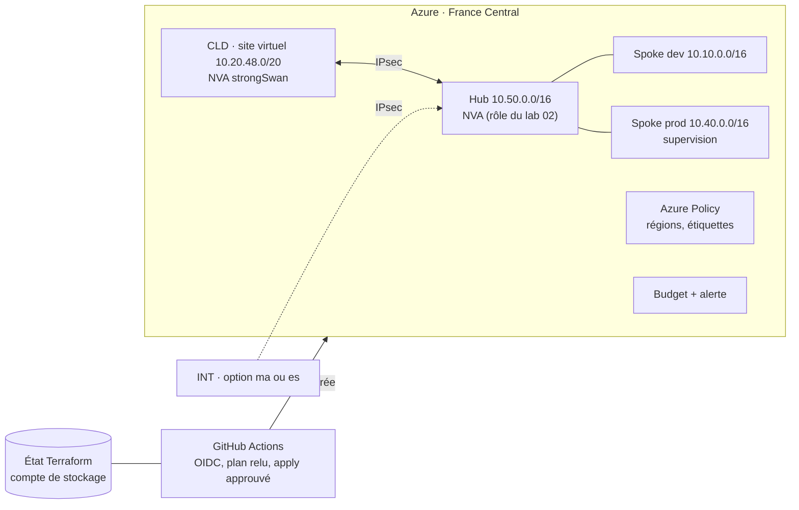

# Lab 04 · Landing zone Azure

> **HubLabs · Usine HubLabs.** HubLabs accueille son application de supervision dans une landing zone hub-spoke : hub 10.50, dev 10.10, prod 10.40. Le site virtuel CLD est relié au hub comme un site physique.
>
> **Pitch (EN)** : A hub-and-spoke Azure landing zone deployed only through a reviewed pipeline with federated identity, guarded by policies and a budget, and destroyed every evening.

| Statut | Semaine | Coût | Exécution | Emplacement |
| --- | --- | --- | --- | --- |
| À faire | S5 | ≤ 15–20 €, à mesurer | cloud | `labs/04-landing-zone-azure` |

## Le problème métier

Migrer une application de supervision vers Azure sans socle, c'est empiler des ressources nommées au hasard, ouvertes sur Internet et payées par oubli. Une landing zone fixe les règles avant la première ressource : réseau hub-spoke, régions autorisées, étiquettes obligatoires, budget, et un déploiement qui passe par un pipeline sans secret stocké.

## Schéma



## Ce que ça démontre

- Un réseau hub-spoke conforme au plan d'adressage, écrit en Terraform.
- Un déploiement sans secret statique (OIDC) avec plan relu et apply approuvé.
- Une gouvernance active : régions autorisées, étiquettes obligatoires, budget avec alerte.
- Un socle jetable : destroy puis apply redonne le même plan.

## Place dans le portfolio

| Sites concernés | S'appuie sur | Fournit |
| --- | --- | --- |
| AZ (hub et spokes), CLD, INT (option) | 02 (rôle `nva`) | Identifiant du VNet hub et état Terraform distant (labs 05 et 07) |

Sites, plages, nommage et flux viennent du [référentiel](../../docs/referentiel/README.md). Aucune valeur en dur dans ce lab.

## Exécution

En CI, depuis n'importe quel poste :

```bash
gh workflow run labs -f lab=04                    # contrôle du lab
gh workflow run labs -f lab=04 -f site_intl=ma    # variante site international
gh run watch
```

En local (cible, disponible quand le lab est implémenté) :

```bash
cd labs/04-landing-zone-azure/terraform
terraform init
terraform plan -out=plan.tfplan
terraform apply plan.tfplan        # seulement après budget et alerte créés
terraform destroy                  # toujours en fin de séance
```

Le workflow `labs` ne fait jamais d'`apply` : il valide et planifie. Le déploiement payant passe par le workflow dédié construit pendant le lab (OIDC, approbation), puis se termine par un destroy.

Conventions détectées par le workflow `labs` : `compose.yaml` (service `tests`, profils `intl-ma` et `intl-es`), `terraform/`, `ansible/`, `gitops/overlays/`. Voir la [méthode](../methode.md).

## Option site international

`SITE_INTL=es` : ressources du site placées en Spain Central si la politique de régions l'autorise (disponibilité des services à vérifier). `SITE_INTL=ma` : site INT simulé relié en IPsec au hub France Central, faute de région Azure au Maroc à ma connaissance (à vérifier). Le coût supplémentaire est mesuré et consigné **avant** activation.

## Scénario de démo (5 minutes)

1. Historique du pipeline : plan publié, apply approuvé, jamais lancé depuis le poste.
2. Création d'une ressource sans étiquette : refusée par Azure Policy.
3. Ping depuis le site CLD vers le spoke prod à travers le tunnel IPsec.
4. Destroy puis apply : le plan est identique au précédent.

## Documents

[Objectifs](objectifs.md) · [Préparation](preparation.md) · [Planning](planning.md) · [Réplication](replication.md) · [Compte-rendu](compte-rendu.md) · [Preuves](preuves/README.md) · [Décision d'architecture](adr/ADR-001.md)
