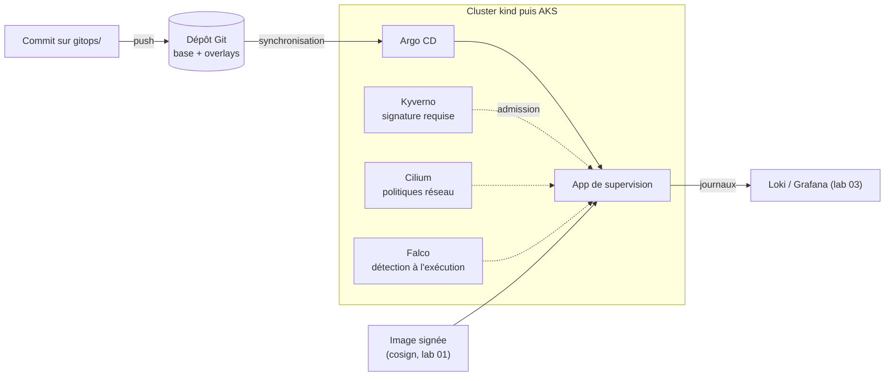

# Lab 05 · Kubernetes GitOps

> **HubLabs · Usine HubLabs.** L'application de supervision de HubLabs tourne sur Kubernetes, d'abord sur kind en local, puis sur AKS dans le spoke prod. Tout changement passe par Git : aucun `kubectl apply` manuel.
>
> **Pitch (EN)** : The supervision app runs on hardened Kubernetes, first on kind then on AKS, and every change goes through Git: no manual kubectl apply, unsigned images refused.

| Statut | Séances de 90 min | Coût | Exécution |
| --- | --- | --- | --- |
| À faire | 4 | 0 € sur kind, AKS à mesurer | local puis cloud |

## Le problème métier

Un cluster administré à la main devient vite un état que personne ne sait reconstruire. Le GitOps fait de Git l'unique source : le cluster converge vers ce qui est fusionné, un retour arrière est un `git revert`, et chaque changement est relu. Ce lab ajoute les garde-fous qu'attend un client sensible : politiques réseau, refus des images non signées, détection d'exécution anormale.

## Schéma



## Ce que ça démontre

- Un déploiement piloté uniquement par Git, avec retour arrière par `git revert`.
- Des politiques réseau qui limitent la supervision à ses dépendances.
- Le refus à l'admission d'une image non signée.
- Les mêmes manifestes sur kind (0 €) et sur AKS.

## Place dans le portfolio

| Sites concernés | S'appuie sur | Fournit |
| --- | --- | --- |
| AZ (spoke prod), INT (option) | 03 (Loki, Grafana), 04 (spoke prod, état distant) | Plateforme GitOps (lab 06) |

Sites, plages, nommage et flux viennent du [référentiel](../../docs/referentiel/README.md). Aucune valeur en dur dans ce lab.

## Exécution

Contrôle en CI, sans rien installer :

```bash
gh workflow run labs -f lab=05                    # contrôle du lab
gh workflow run labs -f lab=05 -f site_intl=ma    # variante site international
gh run watch
```

En local, pas à pas : [guide, section Rejouer](guide.md#rejouer).

## Option site international

Overlay Kustomize `site-int` : fuseau UTC imposé, langue des libellés, configuration propre au site. Le même dépôt GitOps sert la France et l'international ; `SITE_INTL=ma` sélectionne l'overlay.

## Scénario de démo (5 minutes)

1. Changer la version de l'application par commit : Argo CD déploie après le push.
2. `git revert` : Argo CD revient à la version précédente.
3. Déployer une image non signée : refusée par Kyverno, message affiché.
4. Ouvrir un shell dans un pod : alerte Falco.

## Documents

[Objectifs et preuves](objectifs.md) · [Guide](guide.md) · [Journal](journal.md) · [Décision d'architecture](adr/ADR-001.md)
