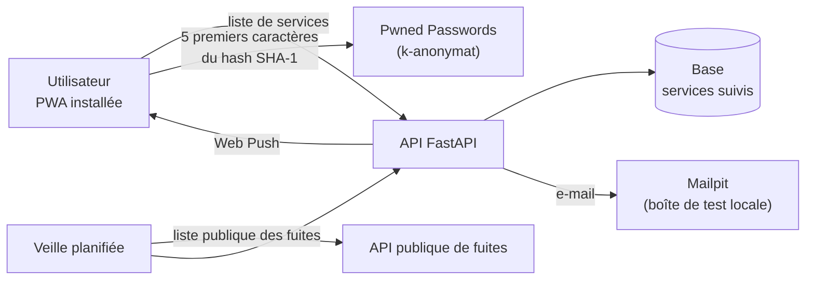

# Lab 06 · Breach Watch

> **HubLabs · Usine HubLabs.** HubLabs veut savoir quand un service utilisé par ses équipes subit une fuite, et alerter les personnes concernées sans jamais manipuler leurs mots de passe.
>
> **Pitch (EN)** : A breach-monitoring web app that alerts users when a service they use is breached, installable on iPhone and Android, without ever handling passwords in clear text.

| Statut | Séances de 90 min | Coût | Exécution |
| --- | --- | --- | --- |
| À faire | 4 | 0 € | local |

## Le problème métier

Quand un service tiers fuit, les comptes des collaborateurs qui l'utilisent deviennent une porte d'entrée, y compris vers l'usine si un mot de passe est réutilisé. Breach Watch suit une liste de services par utilisateur, surveille les fuites publiées et notifie. La contrainte de conception est stricte : l'application ne stocke et ne transmet jamais un mot de passe, ni même son empreinte complète.

## Schéma



## Ce que ça démontre

- Une conception « privacy by design » : le mot de passe ne quitte jamais l'appareil.
- Une veille planifiée sur une source publique de fuites, avec alertes.
- Une application web installable (PWA) avec notifications push sur iPhone et Android.
- Un déploiement GitOps sur la plateforme du lab 05.

## Place dans le portfolio

| Sites concernés | S'appuie sur | Fournit |
| --- | --- | --- |
| LYO, INT (option) | 05 (déploiement GitOps ; Docker Compose en solo) | Alertes de fuites de données |

Sites, plages, nommage et flux viennent du [référentiel](../../docs/referentiel/README.md). Aucune valeur en dur dans ce lab.

## Exécution

Contrôle en CI, sans rien installer :

```bash
gh workflow run labs -f lab=06                    # contrôle du lab
gh workflow run labs -f lab=06 -f site_intl=ma    # variante site international
gh run watch
```

En local, pas à pas : [guide, section Rejouer](guide.md#rejouer).

## Option site international

Ajoute la liste de surveillance du site international (domaine fictif `ma.hublabs.example` ou `es.hublabs.example`), la langue des notifications (français et arabe pour `ma`, espagnol pour `es`) et l'horodatage UTC.

## Scénario de démo (5 minutes)

1. Fuite simulée sur un service fictif suivi : notification push en moins d'une minute.
2. Vérification d'un mot de passe : montrer dans les outils du navigateur que seuls 5 caractères partent.
3. Installation de la PWA sur un téléphone, réception d'une notification.
4. Option `site_intl=es` : même alerte, libellés en espagnol, horodatage UTC.

## Documents

[Objectifs et preuves](objectifs.md) · [Guide](guide.md) · [Journal](journal.md) · [Décision d'architecture](adr/ADR-001.md)
