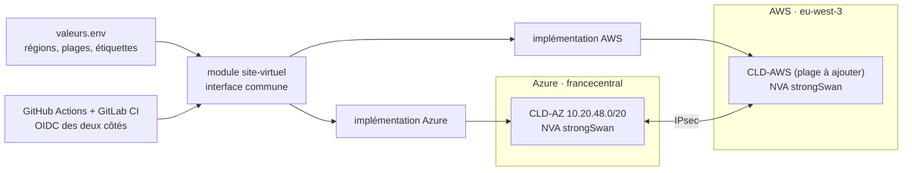

# Lab 07 · IaC multi-cloud

> **HubLabs · Usine HubLabs.** HubLabs veut pouvoir héberger un site virtuel sur Azure ou sur AWS avec le même code. Les modules exposent la même interface, les régions viennent du référentiel.
>
> **Pitch (EN)** : The same Terraform module interface deploys a virtual site on Azure or AWS, both sides linked over IPsec, through reviewed pipelines with federated identity on both clouds.

| Statut | Séances de 90 min | Coût | Exécution |
| --- | --- | --- | --- |
| À faire | 4 | ≤ 15–20 €, à mesurer | cloud |

## Le problème métier

Beaucoup de clients sont multi-cloud par héritage, pas par choix : deux équipes, deux outillages, deux façons de nommer. Ce lab montre une discipline commune : une interface de module identique, des régions et des étiquettes issues du même référentiel, une identité fédérée des deux côtés, et une interconnexion IPsec réelle entre les deux clouds.

## Schéma



## Ce que ça démontre

- Une interface de module unique pour deux fournisseurs.
- Aucune région ni plage en dur : tout vient du référentiel.
- Une identité fédérée OIDC vers Azure **et** AWS, sans clé d'accès stockée.
- Une interconnexion IPsec réelle entre deux clouds, puis un destroy complet des deux côtés.

## Place dans le portfolio

| Sites concernés | S'appuie sur | Fournit |
| --- | --- | --- |
| CLD (Azure et AWS), INT (option) | 02 (rôle `nva`), 04 (OIDC, état distant) | Modules multi-cloud (lab 05 et suivants) |

Sites, plages, nommage et flux viennent du [référentiel](../../docs/referentiel/README.md). Aucune valeur en dur dans ce lab.

## Exécution

Contrôle en CI, sans rien installer :

```bash
gh workflow run labs -f lab=07                    # contrôle du lab
gh workflow run labs -f lab=07 -f site_intl=ma    # variante site international
gh run watch
```

En local, pas à pas : [guide, section Rejouer](guide.md#rejouer).

## Option site international

`SITE_INTL=es` : Azure Spain Central et AWS eu-south-2 (région à activer dans le compte AWS, à vérifier). `SITE_INTL=ma` : régions européennes les plus proches, faute de région au Maroc à ma connaissance (à vérifier), avec la contrainte de protection des données documentée (loi 09-08, à vérifier).

## Scénario de démo (5 minutes)

1. Un paramètre de fournisseur, deux plans : même module, même interface.
2. Recherche dans le code : aucune région en dur.
3. Ping entre le site Azure et le site AWS à travers le tunnel IPsec.
4. Historique des pipelines : plans relus, apply approuvés, destroy vérifié par étiquette.

## Documents

[Objectifs et preuves](objectifs.md) · [Guide](guide.md) · [Journal](journal.md) · [Décision d'architecture](adr/ADR-001.md)
