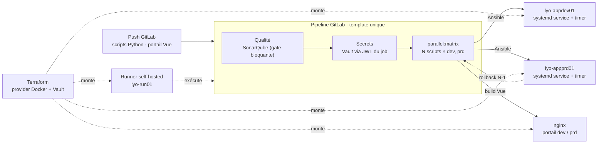

# Lab 08 · Usine de déploiement on-prem

> **HubLabs · Usine HubLabs.** HubLabs déploie ses scripts de maintenance Python et son portail web sur des serveurs fournis par l'usine, sans cloud. Un seul pipeline, un seul modèle, et chaque déploiement est contrôlé, tracé et réversible.
>
> **Pitch (EN)** : An on-prem deployment factory: one GitLab CI template ships many Python jobs to two environments through a self-hosted runner, with a blocking quality gate, secrets pulled from Vault at runtime, systemd timers and one-click rollback.

| Statut | Séances de 90 min | Coût | Exécution |
| --- | --- | --- | --- |
| À faire | 4 | 0 € | local et ci (GitLab) |

## Le problème métier

L'usine exploite des dizaines de scripts de maintenance (purges, exports, contrôles) copiés à la main sur des serveurs, avec des mots de passe dans les fichiers et des tâches `cron` que personne ne sait relire. Chaque mise à jour se fait en dev puis en prod, à la main, sans contrôle de qualité ni retour arrière. Ce lab construit l'usine de déploiement que l'on attend d'une équipe DevOps sur un périmètre on-prem : un modèle de pipeline unique, des serveurs configurés en code, des secrets qui ne quittent jamais Vault et des tâches planifiées que l'on peut lire, superviser et annuler.

## Schéma



## Ce que ça démontre

- Une usine de déploiement **à l'échelle** : un template GitLab CI (`include` et `parallel:matrix`) déploie N scripts sur deux environnements sans copier une ligne de pipeline.
- Une chaîne qui **bloque** : la quality gate SonarQube arrête le déploiement d'un script défectueux.
- **Aucun secret applicatif stocké** : le job s'authentifie auprès de Vault avec son propre jeton d'identité, le secret n'existe que le temps du job.
- Des serveurs configurés en code (Terraform pour l'infrastructure, Ansible pour le système) et des tâches planifiées par **timers systemd**, avec retour à la version N-1.

## Place dans le portfolio

| Sites concernés | S'appuie sur | Fournit |
| --- | --- | --- |
| LYO (IT serveurs) | 00 (poste), 01 (contrôles CI), 02 (rôles Ansible) | Modèle d'usine de déploiement on-prem, parcours de démo B |

Sites, plages, nommage et flux viennent du [référentiel](../../docs/referentiel/README.md). Aucune valeur en dur dans ce lab.

## Exécution

Contrôle en CI, sans rien installer :

```bash
gh workflow run labs -f lab=08                    # contrôle du lab
gh workflow run labs -f lab=08 -f site_intl=ma    # variante site international
gh run watch
```

Le déploiement lui-même tourne dans GitLab, sur le runner local. En local, pas à pas : [guide, section Rejouer](guide.md#rejouer).

## Option site international

Ajoute une troisième cible, `int-ma-app01` ou `int-es-app01`. Le template ne change pas : seule la liste des environnements de la matrice grandit. C'est la preuve que l'usine passe à l'échelle par la donnée, pas par la copie de pipeline.

## Scénario de démo (5 minutes)

1. Pousser un script avec un défaut volontaire : la quality gate SonarQube arrête le pipeline.
2. Corriger et pousser : la matrice déploie 10 scripts sur dev puis prd, en parallèle.
3. Ouvrir le journal du job : le secret lu dans Vault est masqué ; montrer que les variables CI du projet n'en contiennent aucun.
4. Sur la cible prd : `systemctl list-timers 'hublabs-*'`, puis rollback N-1 d'un script en un job.
5. Option `site_intl=ma` : une cible de plus, même template.

## Sous le capot

Le runner partagé de gitlab.com ne voit pas le réseau de l'usine : c'est pour cela que l'usine a son propre runner, étiqueté, auquel les jobs de déploiement sont attachés par `tags`. Pour Vault, le job ne porte aucun mot de passe : GitLab lui délivre un jeton d'identité signé (`id_tokens`) qui atteste le projet, la branche et l'environnement ; Vault vérifie la signature avec les clés publiques de GitLab et n'accorde qu'une politique liée à ces attributs. Le secret est lu pendant le job puis disparaît avec le conteneur. Enfin, un timer systemd n'est pas un `cron` amélioré : c'est une unité avec dépendances, journal (`journalctl -u`), rattrapage des exécutions manquées (`Persistent=true`) et état lisible par la supervision.

## Documents

[Objectifs et preuves](objectifs.md) · [Guide](guide.md) · [Journal](journal.md) · [Décision d'architecture](adr/ADR-001.md)
