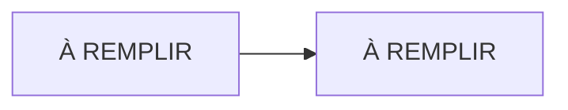

# Lab NN · À REMPLIR

> **HubLabs · Usine HubLabs.** À REMPLIR
>
> **Pitch (EN)** : À REMPLIR

| Statut | Séances de 90 min | Coût | Exécution |
| --- | --- | --- | --- |
| À faire | À REMPLIR | À REMPLIR | local |

## Le problème métier

À REMPLIR

## Schéma



## Ce que ça démontre

- À REMPLIR

## Place dans le portfolio

| Sites concernés | S'appuie sur | Fournit |
| --- | --- | --- |
| À REMPLIR | À REMPLIR | À REMPLIR |

Sites, plages, nommage et flux viennent du [référentiel](../../docs/referentiel/README.md). Aucune valeur en dur dans ce lab.

## Exécution

Contrôle en CI, sans rien installer :

```bash
gh workflow run labs -f lab=NN                    # contrôle du lab
gh workflow run labs -f lab=NN -f site_intl=ma    # variante site international
gh run watch
```

En local, pas à pas : [guide, section Rejouer](guide.md#rejouer).

## Option site international

À REMPLIR

## Scénario de démo (5 minutes)

1. À REMPLIR

## Documents

[Objectifs et preuves](objectifs.md) · [Guide](guide.md) · [Journal](journal.md) · [Décision d'architecture](adr/ADR-001.md)
