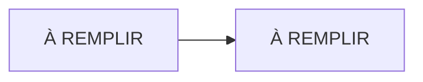

# Lab NN · À REMPLIR

> **HubLabs · Usine HubLabs.** À REMPLIR
>
> **Pitch (EN)** : À REMPLIR

| Statut | Semaine | Coût | Exécution | Emplacement |
| --- | --- | --- | --- | --- |
| À faire | À REMPLIR | À REMPLIR | local | `labs/NN-nom-du-lab` |

## Le problème métier

À REMPLIR

## Schéma



## Ce que ça démontre

- À REMPLIR

## Place dans le portfolio

| Sites concernés | S'appuie sur | Fournit |
| --- | --- | --- |
| À REMPLIR | À REMPLIR | À REMPLIR |

Sites, plages, nommage et flux viennent du [référentiel](../../docs/referentiel/README.md). Aucune valeur en dur dans ce lab.

## Exécution

En CI, depuis n'importe quel poste :

```bash
gh workflow run labs -f lab=NN                    # contrôle du lab
gh workflow run labs -f lab=NN -f site_intl=ma    # variante site international
gh run watch
```

En local (cible, disponible quand le lab est implémenté) :

```bash
cd labs/NN-nom-du-lab
docker compose up -d --wait                           # montage
docker compose run --rm tests                         # un test par objectif
COMPOSE_PROFILES=intl-ma docker compose up -d --wait  # variante site international
docker compose down -v --remove-orphans               # toujours en fin de séance
```

Conventions détectées par le workflow `labs` : `compose.yaml` (service `tests`, profils `intl-ma` et `intl-es`), `terraform/`, `ansible/`, `gitops/overlays/`. Voir la [méthode](../methode.md).

## Option site international

À REMPLIR

## Scénario de démo (5 minutes)

1. À REMPLIR

## Documents

[Objectifs](objectifs.md) · [Préparation](preparation.md) · [Planning](planning.md) · [Réplication](replication.md) · [Compte-rendu](compte-rendu.md) · [Preuves](preuves/README.md) · [Décision d'architecture](adr/ADR-001.md)
